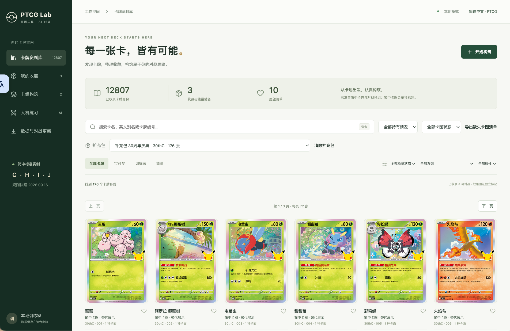
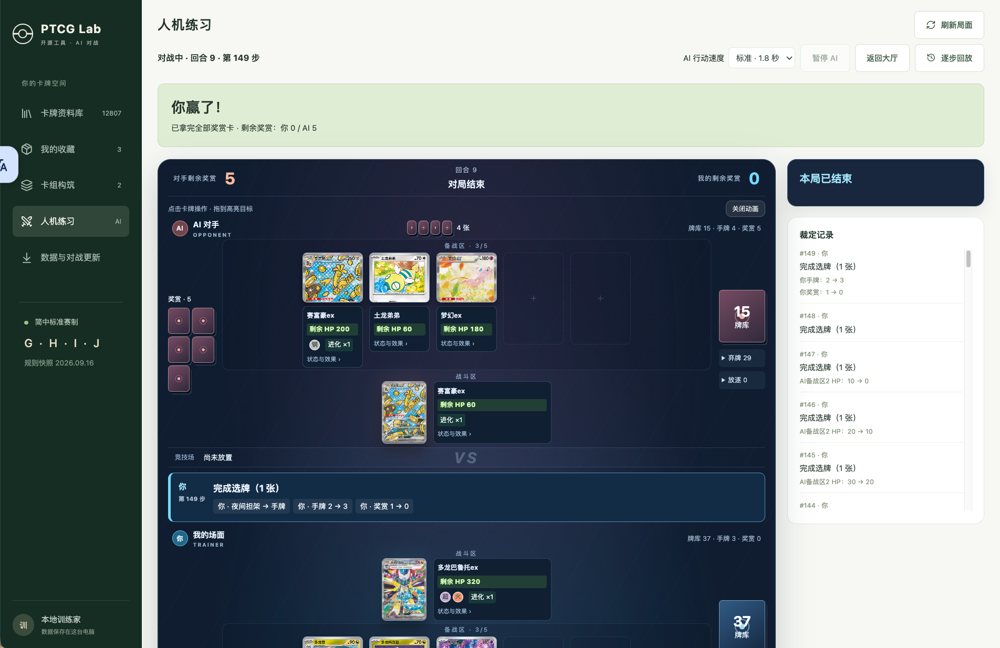

# PTCG Lab

面向 Pokémon Trading Card Game（PTCG）的非官方开源工具，提供简体中文卡牌查询、收藏管理、卡组构筑和本地人机对战，并推进纯 API 网络对战与统一产品体验。PTCG-Lab 独立于原项目，不包含 AI 研究或训练任务；人机练习属于本产品正常维护的功能。

应用通过浏览器使用，由本机服务和 SQLite 数据库保存资料。

## 功能

- **卡牌查询**：搜索卡牌，查看规则文字、扩充包与卡面版本。
- **收藏管理**：记录持有数量，管理同编号的不同卡面，导入和导出收藏。
- **卡组构筑**：创建、编辑和校验卡组，管理可用于对战的卡组版本。
- **人机练习**：使用内置 AI 对战，查看动作与投币动画，恢复对局并观看回放。
- **资料同步**：从兼容的公开 GitHub 数据仓库更新卡牌资料和图片。
- **规则与回放**：维护产品规则执行、对局回放及功能回归；研究训练不属于本项目范围。

人机练习默认使用 **H2**，提供长毛巨魔、沙奈朵、多龙、N 索罗亚克、电电虫 Box 五套预设。精确匹配卡表和规则环境时，五套预设自动使用已验收的专属策略；其余卡表使用通用 H2。保留基础 A1 与实验性 A2 搜索原型。

## 界面预览

### 卡牌资料库

按名称、编号、扩充包和属性筛选卡牌，浏览卡面并管理收藏。



### 人机练习

查看对战场面、奖赏卡与裁定记录，支持 AI 行动速度调整和逐步回放。



## 快速开始

### 环境要求

- Python 3.14 或更新版本
- Node.js 与 npm
- Git
- 现代浏览器
- 首次安装时用于下载依赖的网络连接

### 准备本地资产

**本仓库不包含完整卡牌数据、图片和对战引擎运行时，克隆源码后需要另行配置本地资产。**

如果已有合法、可信且与当前代码兼容的完整本地环境，可在项目根目录导入所需资产：

```bash
python3 scripts/public/import_local_assets.py /path/to/your/trusted-private-project
```

Windows 使用 `python` 执行相同脚本，并将路径替换为实际目录。导入工具复制卡牌数据、引擎运行时和完整性清单；目标文件已存在时会拒绝覆盖。资产来源与配置详情见 [本地资产与公开源码说明](docs/GitHub发布与隐私.md#公开源码如何启动)。

### 安装与启动

在项目根目录执行以下命令。

**Windows PowerShell**

```powershell
.\start.ps1 -Setup
# 后续启动
.\start.ps1
```

**Linux / Bash**

```bash
bash start.sh --setup
# 后续启动
bash start.sh
```

启动后访问 **http://127.0.0.1:8765/**，保持终端运行，按 `Ctrl+C` 停止服务。默认服务仅监听本机地址。

| 操作 | Windows PowerShell | Linux / Bash |
| --- | --- | --- |
| 检查运行环境 | `.\start.ps1 -Check` | `bash start.sh --check` |
| 使用其他端口 | `.\start.ps1 -Port 8766` | `bash start.sh --port 8766` |

详细安装步骤、使用方法与故障排查见 [安装与使用手册](docs/启动使用与跨系统迁移.md)。

## H2 人机练习

1. 打开“人机练习”，在“快速使用推荐预设”中选择自己的卡组；系统会保存可对战版本。
2. 选择“AI 卡组”，保留默认“进阶 AI（H2 · 推荐）”，开始对局。
3. 对局顶部显示“长毛巨魔专属 v22”“沙奈朵专属 v5”“多龙专属 v9”“N 索罗亚克专属 v3”“电电虫专属 v1”或“原 H2”。更换策略需新开对局。

自定义卡表只有与已验收卡表完全一致时才启用专属策略；其他构筑的强度尚未验证。H2 是启发式策略，不需要模型、API Key 或联网推理。

已有安装更新源码后若仍使用旧 AI，请按 [H2 使用与升级说明](docs/H2使用与升级.md) 发布新的本地 API 快照；只刷新浏览器不会替换已固定的后台发布。

## 技术栈与目录

前端使用 React、TypeScript 和 Vite，后端使用 Python 和 FastAPI，数据存储使用 SQLite。

```text
apps/
  api/            后端接口
  web/            浏览器界面
packages/         收藏、卡组、规则、对战、模拟与同步逻辑
rulesets/         规则配置
scripts/          安装、数据同步、构建与开发工具
tests/            自动化测试
docs/             项目文档
```

本地运行时使用 `.venv/` 保存 Python 环境、`runtime/engine/` 保存引擎、`var/` 保存用户数据。这些目录由 Git 忽略。备份和恢复方法见 [安装与使用手册](docs/启动使用与跨系统迁移.md#备份恢复与升级)。

## 文档

- [安装、使用、备份与迁移](docs/启动使用与跨系统迁移.md)
- [H2 使用、升级与回滚](docs/H2使用与升级.md)
- [检索牌库浏览与 AI 可见信息](docs/对战-检索牌库浏览与AI可见信息.md)
- [架构与维护](docs/架构与维护.md)
- [产品化重构设计（P5.5 已完成）](docs/产品化重构设计.md) · [分阶段实施](docs/产品化重构分阶段实施.md) · [多局并发验收](docs/在线对战并发与容量验收.md)
- [P1 迁移基线、包骨架与发布门禁验收](docs/P1迁移基线与发布门禁验收.md)
- [P3 共享界面与本地产品接入](docs/P3共享界面与本地接入实施记录.md)
- [P3-B 本地人机适配验收](docs/P3B本地人机适配验收.md)
- [P3-C 完整产品接入与回退](docs/P3C完整产品接入验收.md)
- [P4 纯 API 服务与认证基础](docs/P4纯API服务实施记录.md)
- [P4-B 房间邀请与可靠开局](docs/P4B房间邀请与开局验收.md)
- [P4-C 权威命令、私有推送与回放](docs/P4C对局提交与私有推送验收.md)
- [P4-D 完整自然终局与进程故障恢复验收](docs/P4D完整对局与故障恢复验收.md)
- [P5 本地网络客户端实施记录](docs/P5本地网络客户端实施记录.md)
- [P5-B 本地网络桥接验收](docs/P5B本地网络桥接验收.md)
- [P5-C 本地网络窗口与资源缓存验收](docs/P5C本地网络窗口与资源缓存验收.md)
- [P5-D 完整对局与双设备验收](docs/P5D完整对局与双设备验收.md)
- [Mac 与 Windows 双设备手动测试](docs/P5D双设备手动测试.md)
- [P5.5 产品整合实施设计](docs/P5.5产品整合实施设计.md)：P5.5-A/B/C/D 已按用户确认完成；P6-A/B 已完成基线观测、有界连接池、集中推送与持久补漏；P6-C 公平调度已完成；P6-D 常驻 worker 与已提交缓存已完成。
- [P5.5 产品整合实施记录](docs/P5.5产品整合实施记录.md)
- [P5.5 完成记录与后续跟进](docs/P5.5产品整合完成记录.md)
- [P6 多局调度与性能实施记录](docs/P6多局调度与性能实施记录.md)
- [P2-D 等价与隔离验收](docs/P2D等价与隔离验收.md)
- [P2-C 核心提取与兼容层验收](docs/P2C核心提取与兼容层验收.md)
- [P2 共享协议与规则核心进度（P2 已完成本地等价与隔离验收）](docs/P2共享协议与规则核心实施记录.md)
- [同编号多卡面收藏](docs/同编号多卡面收藏.md)
- [上游卡库同步](docs/上游卡库同步.md)
- [公开源码、本地资产与隐私](docs/GitHub发布与隐私.md)

## 参与贡献

欢迎通过 Issue 报告问题、提出建议，或通过 Pull Request 提交改进。开发环境与测试说明见 [贡献指南](CONTRIBUTING.md)，安全问题的报告方式见 [安全说明](SECURITY.md)。

## 许可证与致谢

项目自有代码和文档采用 [MIT 许可证](LICENSE)。第三方代码、卡牌数据、卡图及商标遵循各自的许可与使用条件。

感谢 [ptcg-engine](https://github.com/gemelom/ptcg-engine) 提供规则引擎基础，以及 [PTCG-CHS-Datasets](https://github.com/duanxr/PTCG-CHS-Datasets) 提供简体中文资料来源。完整来源和版权信息见 [第三方声明](THIRD_PARTY_NOTICES.md)。

本项目与 Pokémon 官方无隶属或背书关系。

- [P5.5 完整产品双设备验收](docs/P5.5完整产品双设备验收.md)：Mac 与 Windows WSL2 各一个 APP，共用平台卡组、164 张批准卡图测试缓存及统一授权入口。

- [P5.5 对局反馈修复与覆盖升级](docs/P5.5对局验收问题修复.md)：中文显示、浅色配色、后台通信稳定性、过程记录与终局回放。
