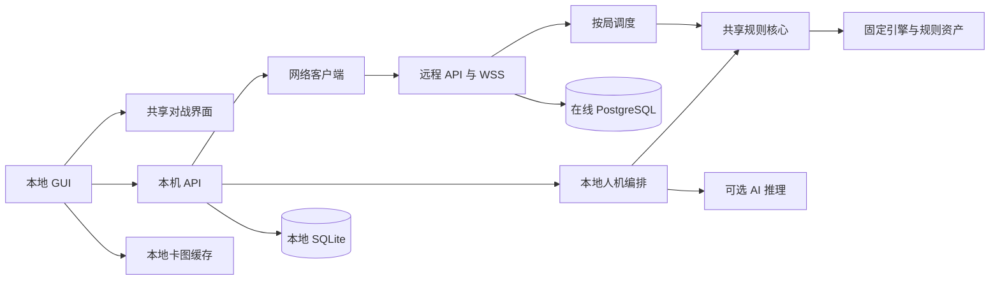

# PTCG Lab 产品化重构设计

<!-- migration-phase: P2; production-routing: legacy -->

日期：2026-10-23。状态：P1 已提交；P2-A/B/C/D 已完成本地验收，P3—P8 尚未实施。实施主仓库为 PTCG-Lab；现有产品运行代码、规则版本和启动方式保持不变。

P2 进度及验证范围见 [P2 实施记录](P2共享协议与规则核心实施记录.md)。

配套文档：[分阶段实施](产品化重构分阶段实施.md)、[多局并发与容量验收](在线对战并发与容量验收.md)。现行产品架构仍以[架构与维护](架构与维护.md)为准；开源交付遵循[公开源码与隐私](GitHub发布与隐私.md)、[第三方声明](../THIRD_PARTY_NOTICES.md)。

## 1. 决策与范围

采用同一 Git 仓库、多项目、独立依赖和独立发布。PTCG-Lab 承担本地产品、纯 API 在线服务、共享规则与协议的维护；现有研究工作区转为 AI 演进主环境，保留活跃实验、模型、诊断和原运行服务。目录分工的调整不意味着立即移动或删除其中的产品代码，也不自动迁移现有用户数据。

第一轮产品目标：本地 GUI 支持收藏、构筑、人机与网络对战；在线服务支持房间码邀请、双人无计时对战、私有回放与断线恢复；小型服务器通过事件推送、按局调度及缓存服务多场对局。

本轮设计不加入排位、聊天、观战、正式赛事时钟、云收藏、自动 AI 接管、付费系统或多区域集群。正式账号与跨设备身份恢复留有接口，但不作为邀请对战的前置条件。浏览器加本地服务继续是 APP 形态，不要求先换成 Electron/Tauri 或原生桌面框架。

### 1.1 两个工作区的职责

| 内容 | AI 演进工作区 | PTCG-Lab |
| --- | --- | --- |
| AI 策略、训练与新特征试验 | 主要开发、长期运行、保留完整诊断 | 接收经过验证的稳定推理包；需要公开复现时接收独立训练工具 |
| 本地 GUI、网络客户端、服务器 | 既有实现作为只读移植参考 | 新功能与重构的维护主线 |
| 通用规则及协议 | 可基于固定版本建立实验分支 | 稳定版本的唯一产品发布源 |
| 私人数据、检查点和凭据 | 原地保存、独立备份 | 不通过同步代码导入 |
| 稳定修复回流 | 提供最小补丁、来源快照、合成复现 | 评审、回归、形成新版本后再供研究环境主动采用 |

产品仓库保留现有人机功能，不因“研究专用工作区”而删掉已发布的 H2/A1/A2 入口。未来公开稳定训练代码仍符合原开源方向，但以独立工具和可选依赖发布，不成为 GUI 或在线服务的默认依赖。

两个工作区之间不得通过符号链接、共享虚拟环境、自动 rsync 或直接引用研究源码形成运行时依赖；同一产品仓库内的开发期 workspace 链接不受此限制，发布制品仍须独立。研究任务也不自动追踪产品核心最新版；已开始的 run 继续锁定原代码和数据。

## 2. 已核对的基线与差距

截至本设计，PTCG-Lab 工作树在修改文档前干净，基线提交为 `bfe0799`（H2 专家同步与 Windows 兼容）。已有 `apps/api`、`apps/web`、共享规则、SQLite、本地版本冻结和开源导出工具；没有 `apps/online`、`packages/online`、`apps/web/src/battle` 或独立训练 APP。

研究工作区已有独立对战界面、网络邀请服务、双人测试及双架构 Docker 打包。它们是待筛选移植来源，不能写成 PTCG-Lab 已有能力，也不能将该环境的验收直接记为本仓库通过。现有在线实现的单计算进程、全局执行锁、32 局缓存、每连接约 0.75 秒查库和 100 并发限制，均为待替换基线，不是产品容量结论。

本机 PTCG-Lab 工作目录存在被忽略的运行资产及用户数据库，不代表这些资产已进入公开 Git。不得因为目标是开源目录就假定其中每个文件都适合发布。

| 当前来源 | 提取后的归属 | 拆分要求 |
| --- | --- | --- |
| `packages/rules`、`packages/engine_adapter` | battle-core | 规则执行、决策、视角投影；不导入 APP、数据库或 AI |
| `packages/battle/runtime.py`、`prompts.py` | battle-core | 移除根目录寻址、导入时 I/O 和全局 `sys.path` 注入 |
| `packages/collection/domain.py` | battle-core + 本地领域层 | 只提取纯卡牌查询、卡组规范化/校验；收藏数量、持久化和上传留在本地 |
| `packages/collection/card_media.py` | 本地资源层 | 图片缓存与上传不进入对战核心；卡牌文字读取改用 CatalogProvider |
| `packages/simulation/events.py`、`results.py`、`registry.py` | battle-core | 提取对战事件、结果和效果版本；不导入搜索、训练或评估 |
| `packages/cardpool/scope.py`、赛制配置 | battle-core + 规则资产包 | 准入与配置分开；不把训练导出代码整体搬入 |
| `packages/battle/presets.py` | 产品资源配置 | 预设供演示/快速开局，不限制真人只能选研究用卡表 |
| `runtime/engine`、引擎构建脚本 | engine-provider + 构建工具 | 固定上游与补丁，保留许可；运行不要求构建脚本位于源码根目录 |
| 当前本地 `apps/api`、collection/store、sync | desktop-api | 保留本地 SQLite、收藏与更新能力 |
| 研究环境 `apps/online`、`packages/online` | online-server | 选择性移植认证、房间、存储、恢复；重做客户端认证和调度 |
| 研究环境 BattleArena/BattleScreen 等 | battle-ui | 展示组件不自行请求、鉴权、裁定或调度 AI |
| 研究环境 OnlineApp | 本地网络大厅 + online-client | GUI 与传输逻辑拆开，不直接复制成公网网站 |

规则迁移与规则修复分开提交。结构重构先证明等价，再选择性引入研究环境中通过验收的效果修复，防止同步整套规则改变产品 H2 的已验证行为。

## 3. 目标仓库及依赖边界

以下为目标结构，P1 已建立包元数据和无运行功能的骨架；旧路径仍是实际产品入口。

```text
apps/
  desktop-api/         本机 FastAPI、SQLite、资源提供和本地网络桥接
  desktop-web/         React GUI：资料、构筑、人机与网络大厅
  online-server/       HTTPS API、WSS、认证、房间、持久化和调度
packages/
  battle-core/         Python 规则接口、决策、投影及结果
  engine-provider/     经核验的引擎加载接口；运行资产另外管理
  battle-protocol/     JSON Schema 单一协议源 + Python/TS 生成类型
  battle-ui/           React 对战、全屏与回放组件
  online-client/       Python 远程协议客户端，由本地后台使用
  ai-runtime/          可选的产品推理适配与已发布策略
resources/
  schemas/             规则/显示资源清单的 schema
  examples/            原创合成示例，不含完整第三方卡池
releases/              产品组合清单：版本、哈希、兼容区间，不含运行数据
ops/online/            Docker、Compose、示例配置、部署说明
scripts/               构建、导出、验证与迁移工具
tests/                 合同、跨包、端到端和故障测试
benchmarks/online/      并发压测驱动与合成场景
```

当前 `data/`、`runtime/`、`var/`、`.catalog/` 的真实资产仍被排除出普通 Git，不因上表更改公开边界。训练工具可在后续发布为独立 `tools/trainer`，本轮不迁移正在运行的实验。



Python 项目各有 `pyproject.toml`、`src/` 包目录和测试，导入名使用 `ptcg_core`、`ptcg_protocol`、`ptcg_online_client` 等，避免继续依赖笼统的顶层 `packages`。独立 wheel 是跨项目交付边界，生产安装不使用 editable 或开发路径。Python 打包采用标准项目元数据和 wheel，不要求立即切换整个环境管理工具。[PyPA 打包流程](https://packaging.python.org/en/latest/flow/)

前端采用 npm workspaces 管理 desktop-web、battle-ui 和协议 TS 包；同仓库构建共享根锁文件，各包保留独立导出边界，CI 检查不从其他包的 `src` 私自导入。[npm workspaces](https://docs.npmjs.com/cli/using-npm/workspaces/)

每个可部署 APP 有独立的运行依赖锁和构建输出。源码允许开发时联调，但发布时锁定内部包的版本与制品 SHA-256。工具链升级另开变更，本轮先沿用现有 Python 3.14 及已验证的前端工具链。

### 3.1 必须自动检查的依赖规则

- battle-core / engine-provider 不依赖 FastAPI、PostgreSQL、SQLite 存储、React、AI 策略或训练工具。
- online-server 不导入 desktop-api、collection/store、sync 管理接口或 ai-runtime。
- battle-ui 只接收视角 DTO、展示资源与回调，不访问 Cookie、远程令牌、服务器地址或规则对象。
- online-client 不读取收藏数据库；接收调用方明确提交的卡表，向 GUI 返回经过筛选的本机 DTO。
- AI 只通过合法 observation/decision 接口行动；不得通过新共享包绕过原有隐藏信息约束。
- 私有引擎记录和随机种子使用独立服务端类型，不进入可生成到浏览器的协议 schema。

## 4. 规则核心、资源和版本

### 4.1 可安装的核心接口

初始接口围绕现有能力提取，不重写所有规则：`validate_deck`、`create_match`、`restore_from_record`、`apply_command`、`project_view`、`export_recovery_record`。这些名称是目标合同，不是现有公开函数。

构造核心时显式传入 RuleBundle/CatalogProvider/EngineProvider。模块导入不读取工作区根路径、用户数据库或网络。核心接收服务器生成的随机种子，每局持有独立随机数状态、游戏实例和决策状态；共享目录及规则元数据应不可变。并行支持必须测试引擎是否仍有全局随机状态、可变注册表或猴子补丁泄漏，不能仅因 matchId 不同就认定隔离成立。

普通 UI snapshot 不是可恢复的引擎 checkpoint。现有引擎含生成器/暂停选择状态，恢复仍从固定种子、卡表及已提交命令重放并校验摘要。序列化完整状态是后续独立研究项，不使用 pickle 或反序列化客户端对象作为捷径。

### 4.2 资产拆分

| 资产 | 服务端 | 本地 APP | 发布方式 |
| --- | --- | --- | --- |
| 规则运行包 | 必需：映射、效果、赛制、卡牌执行数据、引擎哈希 | 本地人机必需；网络显示不执行它 | 私有构建输入或具有明确分发许可的包 |
| 卡牌展示包 | 不作为常规对战响应提供全库 | 卡名、文字、图片索引、版本 | 清单+增量获取；仅在权限允许时分发实际资源 |
| 图片文件 | 不进入对战镜像 | 内容寻址本地缓存 | 允许的资源来源或独立分发渠道 |
| AI 推理包 | 不需要 | 人机模式可选 | 与特征/动作版本绑定，权重单独管理 |
| 用户数据 | 仅在线自身数据 | 收藏、本地卡组、私人回放 | 各自备份，不进镜像或源码 |

图片用 printingId/资源 ID 映射内容哈希；不要仅按卡名覆盖不同卡面。缺图显示卡名与占位，规则继续执行。下载支持长度/大小限制、哈希校验和原子落盘；文件路径由受控缓存生成，不接受清单中的任意写入路径。来源信任与内容哈希是两件事：采用固定信任源或签名清单，不信任服务器临时提供的任意下载地址。新规则包的启用不能覆盖旧对局引用的资源。

### 4.3 版本字段的区别

| 字段 | 含义及兼容策略 |
| --- | --- |
| coreVersion | 可安装核心代码版本；发布制品锁定哈希 |
| ruleReleaseId | 执行代码、引擎、语义数据和规则配置的内容身份；每局固定 |
| protocolVersion | 网络字段、消息及交互合同；主版本不兼容则拒绝连接 |
| displayCatalogVersion | 本地名称/文字/资源映射版本；与规则 ID 映射可验证 |
| assetManifestVersion | 图片资源清单；单纯换图不改变裁定版本 |
| aiPackageVersion | 人机模型/策略/特征版本；不影响网络对战准入 |
| replaySchemaVersion | 本人可见回放的格式；与执行恢复记录分开 |

当前 implementation_id 将源码路径、构建脚本等纳入哈希；移动文件也会改变身份。因此不把目录迁移视为可自动继续旧对局的“无版本变化”。兼容阶段保留旧冻结运行时供旧人机局使用；在线新项目使用新规则身份开新局。不要改写旧 releaseId 或跳过完整性检查。

新的发布清单为有序、规范化的逻辑组件哈希集合，记录构建工具版本和生成结果。只有展示资源更新可以独立发布；规则效果或执行依赖改变必须生成新 ruleReleaseId。行为等价验证不能替代明确的旧记录迁移协议。

## 5. 本地 GUI 和在线连接

### 5.1 展示合同

BattleArena 保持独立全屏与回放显示，接收 `view`、`viewerSeat`、`cards`、`busy/error`、`pendingCommand`、`onSubmit/onRetry/onResign/onLeave` 和回放控制。AI 的速度、暂停和单步通过模式插槽提供，不写入公共协议。

本地人机与在线模式分别持有控制层。在线收到的 PLAYER2 视角由服务器生成，客户端不通过交换双方字段构造。动画只消费可见事件，不控制服务器推进；动画落后时可跳至最新局面，不能阻塞另一位玩家。回放中的历史决策永远只读。

保留现有收藏、卡组编辑、同步和人机入口。新增“网络对战”页：选择已配置服务器、创建/恢复本机游客身份、导入卡组、创建/加入房间、准备、进入 Arena。提交卡组只包含 printingId、数量及可选名称，不包含收藏数量、备注、图片、用户数据库或本地路径。

### 5.2 本地桥接和认证

浏览器仅访问本机 API，本机后台通过 online-client 访问远程 HTTPS/WSS。在线凭证由后台保存，不进入浏览器 localStorage，不把远程 Set-Cookie 透传成本机 Cookie。

本机服务继续仅绑定回环地址，使用精确 Host/Origin 检查、受保护的本机会话和 CSRF；新增远程连接、令牌创建、切换服务器和发送命令均属受保护操作。Origin 缺失不能默认放行这些新增路由。服务器地址只能由明确配置选择，默认要求 HTTPS、有效证书且无 URL 内嵌凭据；跳转不能携带 Authorization 到其他域。局域网允许用户显式添加可信地址/CA，不全局关闭证书校验，也不提供任意 URL 的通用代理。

在线 API v2 使用随机不透明 access token（建议 15 分钟）和轮换 refresh token（建议 30 天），令牌以摘要存储，绑定用户、服务器会话及设备记录。刷新在数据库事务内完成；本机客户端合并并发刷新，支持撤销及令牌复用检测。以上期限是可调设计值，游客令牌丢失后的跨设备找回不在首期范围。

refresh token 优先存系统凭据库；不可用时使用本机权限受限的凭据文件并明确告知，不能将可恢复令牌放进公开日志或一般配置示例。使用原生 Python WSS 客户端在握手 Authorization 中携带 access token，不把令牌写进查询字符串。服务器定期核验会话/到期并要求重新连接，不能让已撤销身份无限保留长连接。

研究环境的 Cookie/CSRF 网页 v1 保持原样运行。PTCG-Lab 的 v2 原生客户端 API 与它并行开发，不通过放宽旧 Origin 防护来支持新模式。纯 API 服务器最终不提供 GUI；未来若保留网页客户端，需要独立认证设计，不能直接将后台凭证暴露给浏览器。

## 6. API 与数据合同

目标前缀 `/api/online/v2`。协议 schema 放在 battle-protocol，Python/TS 从同一源生成并校验；不得只依赖 TypeScript 编译类型。v1 到 v2 的兼容只在显式适配器内处理。

| 接口组 | 目标行为 |
| --- | --- |
| GET `/capabilities` | 协议范围、交互能力、可开局规则版本、资源清单身份、容量/维护状态 |
| POST `/sessions`、`/sessions/refresh`、`/sessions/revoke` | 游客设备会话、刷新与撤销；创建接口独立限流 |
| POST `/decks` | 服务端以目标 ruleReleaseId 校验、冻结卡组，返回不可变 revision |
| POST `/rooms`、`/rooms/join` | 房间码邀请，幂等 requestId，限制猜码和房间数 |
| GET `/rooms/{id}`、POST `deck/ready/leave` | 成员授权、roomVersion 冲突检查；换卡组取消准备 |
| GET `/matches/{id}` | 仅本人最新可见状态 |
| POST `/matches/{id}/control`、`commands`、`resign` | 操作端栅栏、幂等命令、裁定与认输 |
| WSS `/stream` | 认证订阅、快照、定向更新、心跳、恢复提示 |
| GET `/matches/{id}/frames`、`timeline` | 本人回放，分页和资源预算；无隐藏恢复记录接口 |

命令示例仅示意字段；ID 格式与长度由合同测试固定：

```json
{
  "commandId": "client-generated-unique-id",
  "expectedMatchSeq": 41,
  "expectedStateVersion": 39,
  "controllerEpoch": 2,
  "decisionId": "decision-for-state-39",
  "choice": {"optionId": "legal-option-id"}
}
```

choice 只能为合法 optionId 或 selectedRefs 之一。身份和 seat 从会话及对局成员关系得出，不能信任请求自报座位；服务器不接受客户端伤害、抽牌结果或局面补丁。HTTP 响应和 WSS 事件可能交错，本地按序号去重，并对未知提交结果重用原 commandId。

`roomVersion` 管赛前状态；`stateVersion` 管引擎决策；`matchSeq` 管对局持久业务状态；`controllerEpoch` 管每位玩家操作权。它们不能互相替代。控制权变化另有定向事件，即使 matchSeq 不变也必须推送。

订阅流增加绑定身份/对局的独立游标 streamCursor：它覆盖状态、控制权和服务状态通知，不能只用 matchSeq 推断是否有更新。客户端提供游标只是恢复位置，不是授权。保留期内补发，超期返回 `RESYNC_REQUIRED` 并取得完整快照；快照与游标的边界必须一致，避免读取期间丢失提交。

初期提交后推送完整的本人快照及本次可见事件；先取消轮询和重复历史，再考虑可见视角上的增量 patch。不会对完整隐藏引擎状态做 diff 后交由客户端过滤。

### 6.1 数据归属

本地继续使用原 SQLite 保存收藏、人机与本地卡组；新网络客户端使用单独存储保存服务器 ID、非秘密会话元数据、待确认命令及已下载的本人回放。密码/令牌走独立凭据库。

在线 PostgreSQL 保存 users/device_sessions、deck_revisions、rooms/members、matches、accepted_commands、frames、outbox。房间到对局的唯一约束、座位唯一性、幂等命令复合键和外键在数据库实现。私有 seed、初始卡组及恢复记录仅服务器/受控备份可读。数据库 migration 属 online-server，不能拿本地 SQLite schema 扩成公网多租户模型。

公开日志只记不可逆关联标识、错误码、耗时和版本；不记录 Cookie/token、卡组内容、隐藏手牌、随机种子或完整命令候选。本人回放即使终局也不自动解锁对手曾经隐藏的牌。

## 7. 多局调度和可靠提交

每局串行队列、跨局公平调度，多个活跃局共享少量工作进程；工作进程内不并发操作同一个引擎实例，按 matchId 保持亲和性。不能简单把现有 ProcessPoolExecutor 的 max_workers 改大，任其随机分配并破坏缓存命中。

提交顺序为：认证/授权及幂等查询 → 有界准入 → 读取已提交基线 → 工作进程计算候选 → 短事务再次比较版本与控制权 → 原子写恢复数据、双方帧、回执和定向 outbox → 提交 → 确认成功并唤醒推送。

数据库序号比较、按局锁及唯一键是最终屏障，进程队列只是调度优化。候选状态在提交前不可用于下一条命令；提交失败或超时后丢弃候选并按持久摘要恢复。丢失提交响应时先查询回执，不能另起命令再次执行。

outbox 使“已提交但还未推送”可恢复。初期单个 API 服务通过内存通知唤醒分发，另有全局低频扫描补漏；后续可用 PostgreSQL NOTIFY 唤醒，但事件仍在表内，不把 NOTIFY 当持久队列。PostgreSQL 的事务通知在提交后交付，可用于这种提示用途。[PostgreSQL 17 NOTIFY](https://www.postgresql.org/docs/17/sql-notify.html)

计算超时最多影响所分配工作进程及其中待恢复的局，不能终止所有进程；共享单核机器无法保证延迟完全隔离，因此还要依赖超时、排队上限、开局准入和资源预算。详细缓存、限流、恢复、推送积压及压测指标见[并发设计](在线对战并发与容量验收.md)。

## 8. 部署、开源与更新边界

### 8.1 三类制品

| 制品 | 内容 | 使用边界 |
| --- | --- | --- |
| 公开源码/基础 API 镜像 | 自有代码、依赖、schema、构建与配置说明、合成示例 | 不默认含完整卡牌运行包；缺资产时 readiness 失败并明确说明 |
| 私有可运行服务镜像 | API、核心、匹配的合法规则运行包及引擎 | 用于有权使用的环境；独立构建，不直接公开现有完整镜像 |
| 本地 APP 发布物 | 本地 API、GUI、共享界面、网络客户端、可选稳定 AI | 图片、数据与权重按各自授权获取，用户数据不随包发布 |

服务器镜像不再包含 React 静态文件、卡图缓存、本地收藏、AI/训练依赖。仅数据库卷、配置和秘密可写；规则包只读且按内容身份固定。新部署使用独立 Compose 项目、数据库卷和端口，不复用研究环境的数据库、CA 私钥或现有服务 PID。

基础镜像的“不含资产”与“可立即开局”不能混写。规则安装渠道、许可与获取步骤需在干净安装验收中实际验证；能导入个人完整环境不等于开源使用者能从零复现。

### 8.2 发布工具需要随目录更新

现有 `scripts/public/export_source.py` 的目录白名单围绕 apps/api、apps/web；扩展名也尚未覆盖新结构需要的全部 toml/yaml/schema/无扩展名 Docker 文件。阶段 P1 就要更新并测试精确允许项，不能等代码迁移后才发现导出缺项目。当前对 fixtures 和 tests JSON 的整体排除需要增加仅原创合成协议夹具的显式允许目录，不能直接放开全部测试数据。

`PUBLIC-SOURCE.json` 是导出时生成的文件清单；本次文档变更不把旧清单当作当前工作区状态，也不手工将其写成新发布。`RELEASE.json` 是既有产品元数据，不在纯文档阶段伪装更新规则版本。每次正式导出重新生成清单并核验包内容。审计须同时覆盖新增未跟踪文件和拟发布制品，不能只扫描 git ls-files。

### 8.3 升级与回滚

在线新规则先阻止新建旧版本局并等待活动局结束，再替换镜像；首期不承诺一台小服务器同时承载多个规则版本。异常回滚须使用匹配代码、规则包、数据库 schema 和备份，不能仅换旧镜像标签。

本地迁移先备份 SQLite，用追加式 schema 和兼容读取保持可恢复。旧人机局由原冻结运行时执行或按现有规则仅回放，禁止原地改写记录哈希。展示资源更新独立于裁定更新。模型升级不要求在线服务器升级；协议变更通过 capabilities 明确兼容范围。

## 9. 完成标准与主要风险

完成不以目录移动为准，而以三个条件为准：本地 APP 独立安装且现有功能回归通过；纯 API 镜像不挂载仓库即可开局；共享核心从 wheel 在仓库外可验证运行。多局能力必须附具体硬件、版本、负载形态和延迟报告，不能以浏览器验收或简单空连接数推定。

| 风险 | 处理 |
| --- | --- |
| 规则代码搬家使 releaseId 改变 | 新身份开新局，保留旧运行时与回放兼容，禁止绕过哈希 |
| 将研究最新代码覆盖稳定 H2 | 先移植界面/在线边界，规则差异逐项验证后单独合入 |
| 导入模块读取磁盘或启动运行时 | 显式 Provider/配置，包导入测试与仓库外 wheel 测试 |
| 本地桥接成为公网转发入口 | 回环绑定、会话授权、精确来源检查、固定服务器配置 |
| 多局共享随机数/可变缓存 | 不可变共享资料、局部 RNG，交错执行与故障恢复摘要测试 |
| 缓存淘汰导致长局恢复拖垮服务 | 内存预算、亲和调度、冷恢复限流，准入限制；不虚构 checkpoint 能力 |
| 开源包带入资产/私有数据 | 精确制品白名单、合成夹具、秘密与路径扫描、清单复核 |
| 未来大量多副本需求 | 另做 ownership lease/fencing 与跨实例推送设计，当前不直接增加 API 副本 |

本设计的实施顺序、每阶段产物、回滚及验收门槛见[分阶段实施文档](产品化重构分阶段实施.md)。
